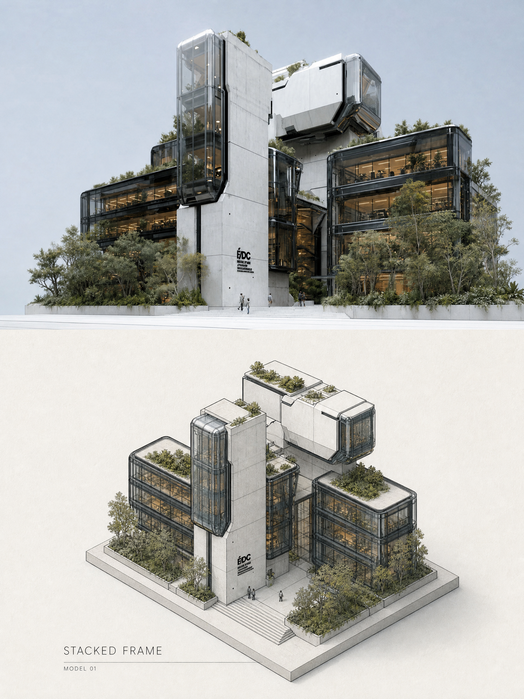
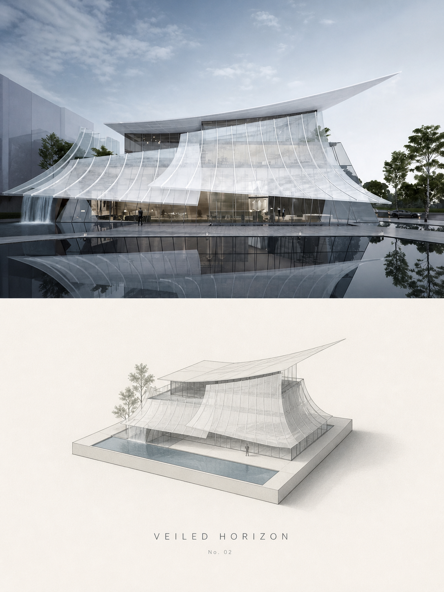
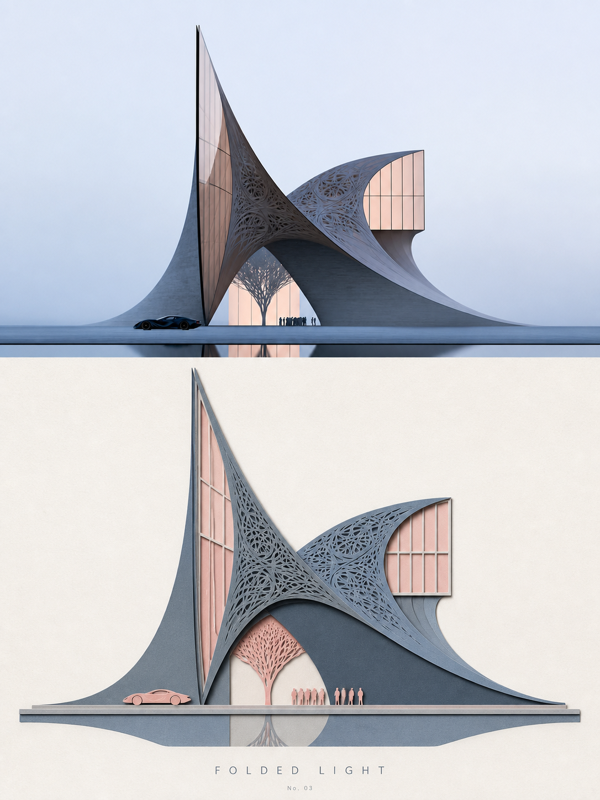
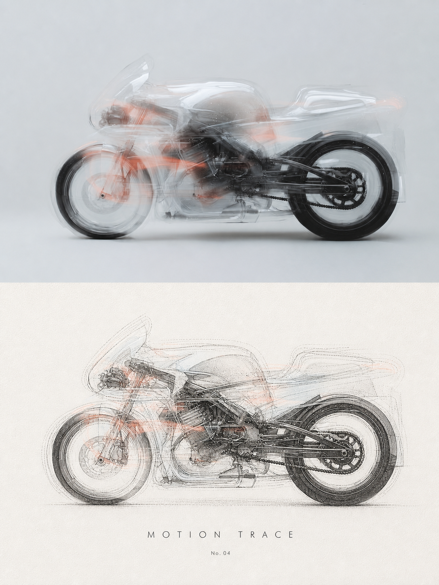
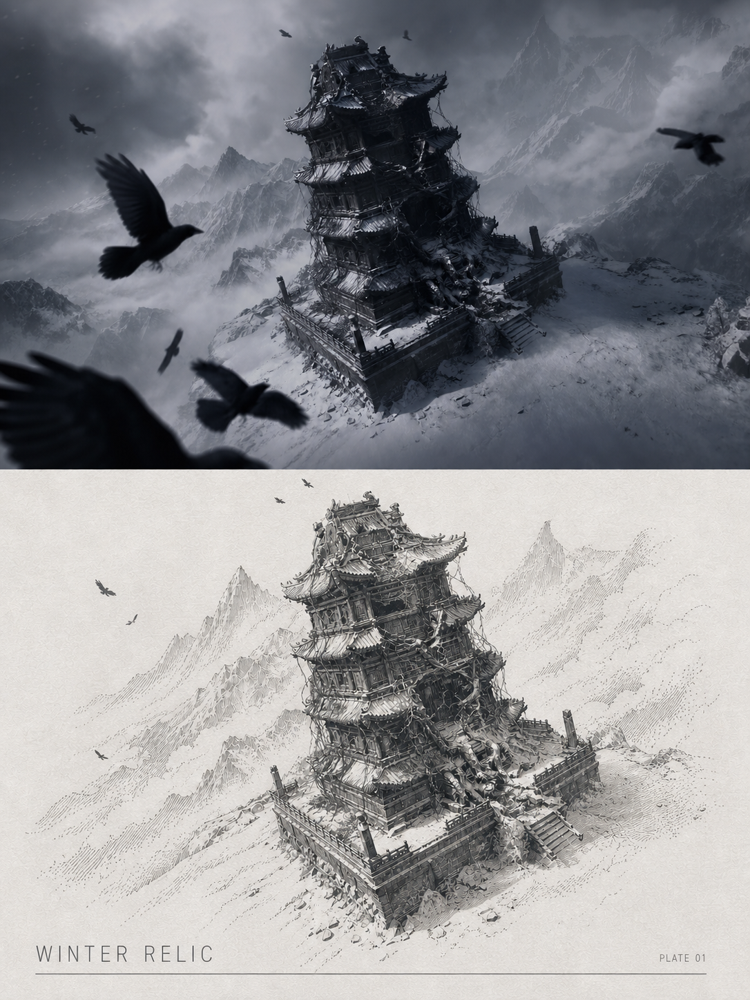
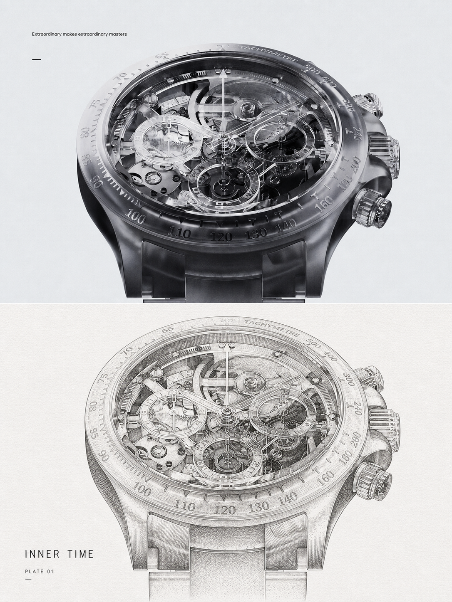
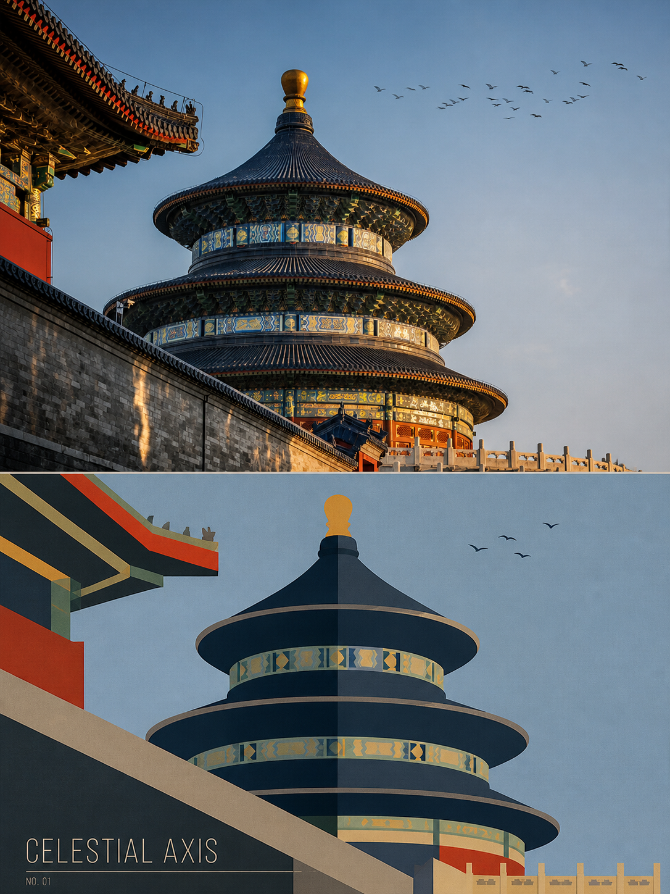
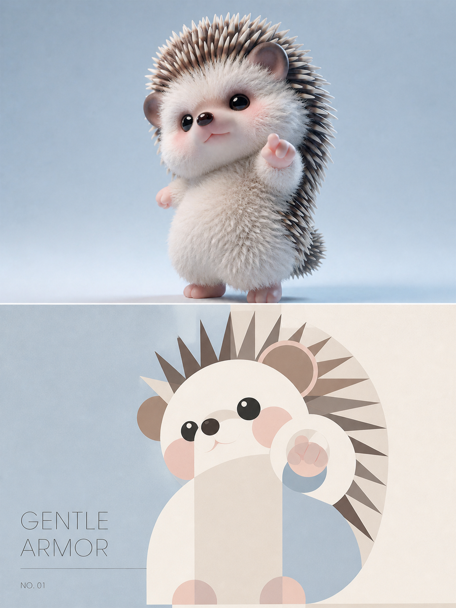

# Photo Dual-Panel Editorial

一个用于 Codex 的照片编辑海报 Skill。它会把用户上传的每张照片分别设计为严格 `3:4` 竖版、上下区域各占 `50%` 的双区编辑海报：上半部分保留真实原片，下半部分采用一种独立画风进行视觉转译。

## 功能

- 三种交付方式：直接出图、只输出提示词、图片与提示词同时交付。
- 四种互斥画风：等距微缩纸模、分层纸雕浮雕、档案蚀刻线描、现代主义几何解构。
- 智能匹配模式：根据每张照片最不可替代的视觉信息选择一种画风。
- 多图逐张处理：每张源照片生成独立成品，避免主体、配色和风格互相污染。
- 从原图提取有限色盘，并生成克制的英文标题与编辑排版。

## 示例

以下成品均由单张照片生成：上半部分保留原始照片，下半部分只采用一种画风进行转译。

### 等距微缩纸模

| Stacked Frame | Veiled Horizon |
| --- | --- |
|  |  |

### 分层纸雕浮雕



### 档案蚀刻线描

| Motion Trace | Quiet Eave |
| --- | --- |
|  |  |

| Winter Relic | Inner Time |
| --- | --- |
|  |  |

### 现代主义几何解构

| Celestial Axis | Gentle Armor |
| --- | --- |
|  |  |

## 安装

将仓库目录复制到 Codex 的个人 Skill 目录：

```text
~/.codex/skills/photo-dual-panel-editorial
```

也可以下载 ZIP，解压后确保 `SKILL.md` 位于 `photo-dual-panel-editorial` 文件夹根目录。

## 使用

在 Codex 中上传一张或多张照片，然后调用：

```text
$photo-dual-panel-editorial
```

如果没有同时指定交付方式与画风，Skill 会先要求补全选择。完整选项如下：

```text
交付方式：
A. 直接出图
B. 只输出提示词
C. 图片和提示词同时交付

下半部分画风：
0. 智能匹配
1. 等距微缩纸模
2. 分层纸雕浮雕
3. 档案蚀刻线描
4. 现代主义几何解构
```

例如：上传照片后回复 `C, 0`，即可让 Skill 智能匹配画风，并同时交付图片与实际使用的完整提示词。

## 运行要求

- 提示词模式可直接使用。
- 直接出图与组合交付模式需要当前 Codex 环境提供图片生成或图片编辑能力。
- 使用他人照片时，请确保你拥有相应的使用和发布权限。

## 许可证

[MIT License](LICENSE)
