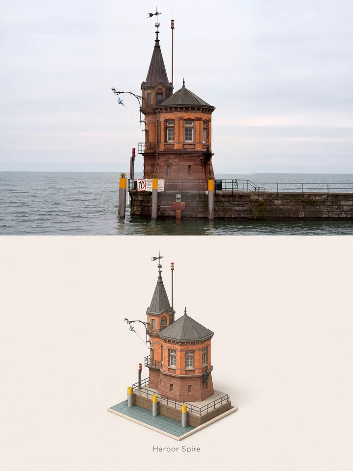
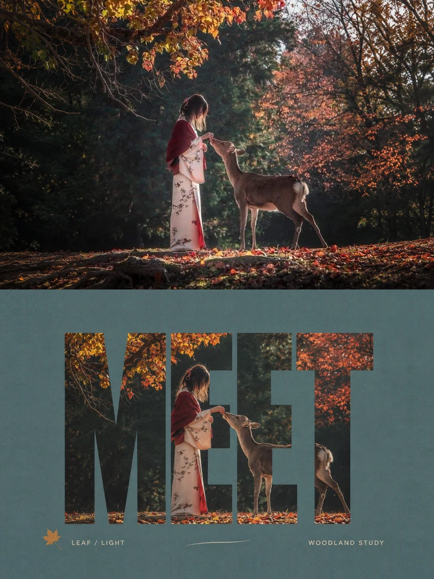
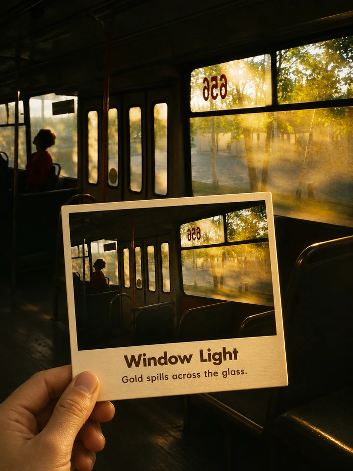

# 照片双区风格海报

把一张照片做成一张 **3:4 竖版编辑海报**。常见版式上半保留原照，下半用纸模、版画、光栅、字形蒙版等方式重构同一画面。也有把原照融进画框或实体相纸的连续单幅版式。

**52 个画风 · 161 张示例预览 · 每张图一段完整提示词**

[下载 ZIP](https://github.com/bertrambryant/photo-dual-panel-editorial/archive/refs/heads/main.zip) · [查看画风选单](references/styles.md#固定映射) · [浏览全部作品](examples/README.md) · [安装到 Codex](#安装到-codex)

## 作品预览

| 等距微缩纸模 | 实验字形摄影蒙版 | 场景中的拍立得 |
| :---: | :---: | :---: |
| <a href="examples/isometric-miniature/harbor-spire.webp"></a> | <a href="examples/experimental-type-photo-mask/meet.webp"></a> | <a href="examples/in-scene-instant-photo/window-light.webp"></a> |
| [Harbor Spire 提示词](examples/isometric-miniature/harbor-spire/harbor-spire-prompt.md) | [MEET 提示词](examples/experimental-type-photo-mask/meet/meet-prompt.md) | [Window Light 提示词](examples/in-scene-instant-photo/window-light-prompt.txt) |

## 按照片题材选风格

| 手上的照片 | 可以从这些风格开始 |
| :--- | :--- |
| 建筑、街道、室内 | [01 等距微缩纸模](references/styles/isometric-miniature.md)突出体量，[36 极简线条视觉归纳](references/styles/minimal-linear-graphic.md)用结构线和标注梳理空间，[47 疾线建筑观察](references/styles/rapid-ink-architecture-study.md)保留钢笔速写的刻画与笔触。 |
| 山海、地貌、植被 | [02 分层纸雕浮雕](references/styles/layered-paper-relief.md)用纸层交代远近，[05 水墨扁平解构](references/styles/ink-flat-deconstruction.md)归纳地貌色层，[44 圆弧矩阵摄影镶嵌](references/styles/arc-grid-photo-inlay.md)用弧形窗口串起同一片景色。 |
| 人物、动物、日常互动 | [04 现代主义几何解构](references/styles/modernist-geometric.md)用色块提炼姿态，[10 超现实孔版动态场](references/styles/surreal-risograph-motion.md)用网点和单一轨迹表现动势，[12 实验字形摄影蒙版](references/styles/experimental-type-photo-mask.md)让主体从字形里穿出。 |
| 旅行片段、光线与记忆 | [17 第二世界连续拼贴](references/styles/second-world-continuity.md)让原景越过中线接入纸面，[43 诗意复古杂志半调印刷](references/styles/poetic-vintage-magazine-halftone.md)结合大字、诗句和原图小样，[46 场景中的拍立得](references/styles/in-scene-instant-photo.md)在连续实景中放入同源相纸。 |

还没选定时，在 Codex 中选 **0 智能匹配**，会逐张根据主体、构图和色彩关系选画风。也可以下载仓库后打开 `examples/gallery.html`，搜索画风编号、并排比较 2–3 个风格，或复制选用指令。

## 安装到 Codex

1. [下载并解压 ZIP](https://github.com/bertrambryant/photo-dual-panel-editorial/archive/refs/heads/main.zip)，将解压出的完整目录命名为 `photo-dual-panel-editorial`。
2. 把目录放到个人技能文件夹。Windows 的 `~` 对应你的用户目录。安装后可在以下位置找到 `SKILL.md`。

   ```text
   ~/.codex/skills/photo-dual-panel-editorial/SKILL.md
   ```

3. 上传照片，在 Codex 对话中输入 `$photo-dual-panel-editorial`，然后选画风和交付方式。可以一次上传多张，每张照片独立制作。

| 交付方式 | 你会收到 |
| :--- | :--- |
| **A**　直接出图 | 每张照片对应一张独立海报。 |
| **B**　只输出提示词 | 每张照片对应一段可直接复制的整图提示词。 |
| **C**　图片和提示词 | 海报与对应的整图提示词。 |

可以直接发这句，或在选单里回复 `C, 12`。

```text
用第 12 项「实验字形摄影蒙版」处理我上传的照片，每张分别出图，并给我一段可直接复制的整图提示词。
```

## 直接在图像模型里用提示词

1. 从[画风选单](references/styles.md#固定映射)打开对应画风，复制「可直接使用的提示词」里的完整文字。
2. 把文字和**你自己的原图**一起提交给支持图片输入的模型，一次请求生成一张完整海报。

画风规范里的通用提示词可搭配该风格适用的新照片。示例索引中标为「可直接复制的整图提示词」的稿件已针对对应样片写好主体、构图和文字。想让提示词贴合你的照片，在 Codex 里选 B 或 C。出图模式和组合模式需要当前环境支持图像生成或编辑。

## 素材与许可证

技能文件的许可见 [MIT License](LICENSE)。示例用于展示画风和构图。对外使用他人原照或样片前，请确认相应素材的使用权限。
